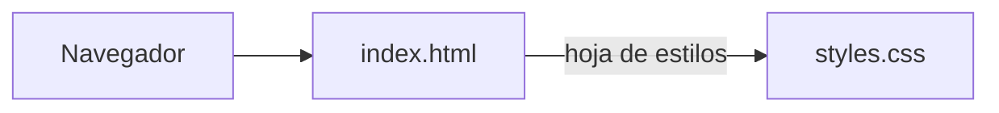
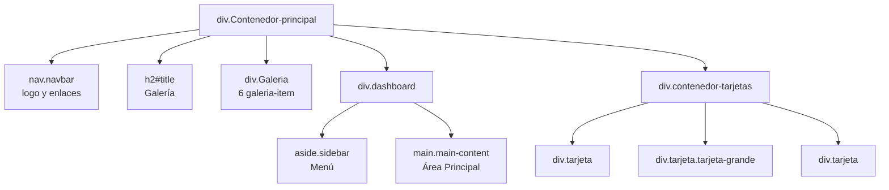

# Maquetación con Flexbox


<!-- TODO: agregar badge de licencia cuando se defina -->

Página web estática, construida solo con HTML y CSS, que reúne cuatro ejercicios de maquetación con Flexbox: una barra de navegación, una galería adaptable, un panel con barra lateral y un conjunto de tarjetas de perfil.

---

## Tabla de contenidos

1. [Descripción y propósito](#descripción-y-propósito)
2. [Características principales](#características-principales)
3. [Vista previa](#vista-previa)
4. [Arquitectura](#arquitectura)
5. [Sistema de diseño](#sistema-de-diseño)
6. [Stack tecnológico](#stack-tecnológico)
7. [Estructura del proyecto](#estructura-del-proyecto)
8. [Requisitos previos](#requisitos-previos)
9. [Instalación y ejecución](#instalación-y-ejecución)
10. [Personalización](#personalización)
11. [Limitaciones conocidas](#limitaciones-conocidas)
12. [Roadmap](#roadmap)
13. [Guía de contribución](#guía-de-contribución)
14. [Créditos y licencia](#créditos-y-licencia)
15. [Autor](#autor)

---

## Descripción y propósito

El proyecto es un ejercicio práctico para dominar el modelo de caja flexible de CSS. Cada sección de la página resuelve un patrón de diseño común, organizado en la hoja de estilos con los comentarios "Primer punto" a "Cuarto punto": navegación horizontal, cuadrícula que se acomoda al ancho disponible, distribución proporcional en columnas y tarjetas con altura uniforme.

**Público objetivo:** estudiantes de desarrollo web que quieran revisar un ejemplo de Flexbox sin frameworks.
<!-- TODO: confirmar público objetivo y, si aplica, agregar contexto académico (materia, institución, objetivos de aprendizaje). -->

## Características principales

- **Barra de navegación** con logo a la izquierda, enlaces a la derecha y color de resaltado al pasar el cursor.
- **Galería** de seis elementos que se reacomodan según el ancho de la pantalla (`flex-wrap`).
- **Dashboard** con barra lateral y área principal en proporción 1:3.
- **Tarjetas de perfil** centradas, con botón de acción y una tarjeta destacada con escala ampliada.
- Degradados, sombras suaves, bordes redondeados y transiciones en enlaces y botones.
- Sin JavaScript ni dependencias: se abre directamente en el navegador.

## Vista previa

<!-- TODO: agregar la captura en docs/img/ y ajustar el nombre de archivo. -->


---

## Arquitectura

### Visión general

Es un **sitio estático de una sola página**. El navegador recibe un documento HTML que referencia una hoja de estilos local. No hay servidor, base de datos, fuentes externas ni lógica de programación.

Principios de diseño observables en el código:

- **Separación de contenido y presentación:** la estructura está en el HTML y la apariencia en `styles.css`.
- **Layout con Flexbox:** todas las secciones usan `display: flex`, sin floats ni posicionamiento absoluto.
- **Organización por secciones:** la hoja de estilos está dividida en cuatro bloques comentados, uno por ejercicio.
- **Estilos reutilizables:** las tarjetas comparten la clase `.tarjeta`, y la variante destacada se obtiene agregando `.tarjeta-grande`.

### Diagrama de componentes



### Estructura del documento



### Contenedores flexibles y responsabilidades

| Sección | Contenedor | Propiedades clave |
|---|---|---|
| Página completa | `.Contenedor-principal` | `flex-direction: column`, `min-height: 100vh` |
| Navegación | `.navbar` | `justify-content: space-between`, `align-items: center` |
| Enlaces | `.nav-links` | `display: flex`, `gap: 20px`, `list-style: none` |
| Galería | `.Galeria` | `flex-wrap: wrap`, `gap: 15px`; cada elemento con `flex: 1 1 200px` |
| Dashboard | `.dashboard` | `display: flex`, `gap: 20px`, `height: 400px` |
| Barra lateral | `.sidebar` | `flex: 1` |
| Área principal | `.main-content` | `flex: 3` |
| Tarjetas | `.contenedor-tarjetas` | `flex-wrap: wrap`, `justify-content: center` |
| Tarjeta | `.tarjeta` | `flex-direction: column`, `align-items: center`; el texto usa `flex-grow: 1` para empujar el botón al fondo |

### Decisiones técnicas clave

| Decisión | Justificación |
|---|---|
| Flexbox como único sistema de layout | Es el objetivo del ejercicio y cubre filas, columnas y reacomodo con `flex-wrap`. |
| `flex: 1 1 200px` con `min-width` en la galería | Los elementos crecen y se reparten el ancho, y bajan de línea cuando no caben. |
| Proporción `flex: 1` y `flex: 3` en el dashboard | Define el reparto del espacio sin fijar anchos en píxeles. |
| `flex-grow: 1` en el párrafo de la tarjeta | Alinea todos los botones en la parte inferior sin importar la longitud del texto. |
| `transform: scale(1.1)` en la tarjeta grande | Destaca una tarjeta sin alterar el flujo del layout. |

### Seguridad, escalabilidad y rendimiento

- **Seguridad:** al ser estático, sin formularios ni scripts, la superficie de ataque es mínima y no hay conexiones externas.
- **Escalabilidad:** agregar elementos a la galería o más tarjetas solo requiere duplicar un bloque HTML; el CSS se adapta solo.
- **Rendimiento:** no hay imágenes ni fuentes externas, por lo que la carga es prácticamente inmediata.

---

## Sistema de diseño

**Paleta de colores**

| Uso | Color |
|---|---|
| Barra de navegación | `#333` |
| Enlace al pasar el cursor | `#ff6347` |
| Título de la galería | `#333` |
| Elementos de la galería | Degradado `#27d30d` a `#0fa158` |
| Barra lateral | Degradado `#1391c7` a `#1c5eeb` |
| Área principal | `#ecf0f1` |
| Tarjetas | Degradado `#f39c12` a `#d35400` |
| Botón de tarjeta | Fondo blanco, texto `#e67e22`; al pasar el cursor fondo `#2980b9` |

**Tipografía:** no se define `font-family`, por lo que se usa la fuente predeterminada del navegador.

**Efectos:** sombra `0 4px 6px rgba(0, 0, 0, 0.1)` en galería, barra lateral y área principal; transiciones de 0.3 s en enlaces y botones.

---

## Stack tecnológico

| Tecnología | Rol |
|---|---|
| HTML5 | Estructura del documento (`nav`, `aside`, `main`) |
| CSS3 | Flexbox, degradados, sombras, transiciones y transformaciones |

## Estructura del proyecto

<!-- TODO: ajustar nombres de archivos y carpetas reales. -->

```
.
├── index.html       # Estructura de la página
├── styles.css       # Hoja de estilos (cuatro bloques por ejercicio)
├── docs/
│   └── img/         # Capturas usadas en este README
└── README.md
```

## Requisitos previos

- Un navegador web moderno (Chrome, Firefox, Edge o Safari).
- Opcional: Visual Studio Code con la extensión *Live Server*.

## Instalación y ejecución

No hay dependencias que instalar.

```bash
# 1. Clonar el repositorio
git clone https://github.com/Campriet03/<nombre-del-repositorio>.git   # TODO: reemplazar por la URL real
cd <nombre-del-repositorio>
```

**Opción A:** abrir `index.html` con doble clic en el navegador. <!-- TODO: confirmar el nombre real del archivo -->

**Opción B:** en Visual Studio Code, clic derecho sobre `index.html` y *Open with Live Server*; la página se recarga automáticamente al guardar.

## Personalización

**Agregar un elemento a la galería:**

```html
<div class="galeria-item">Imagen 7</div>
```

**Agregar una tarjeta:**

```html
<div class="tarjeta">
    <div class="imagen"></div>
    <h3>Nombre</h3>
    <p>Descripción del usuario.</p>
    <button>Ver Perfil</button>
</div>
```

**Destacar una tarjeta:** agregue la clase `tarjeta-grande` junto a `tarjeta`.

**Cambiar colores:** edite los degradados y valores hexadecimales en `styles.css`.

**Cambiar la proporción del dashboard:** modifique los valores `flex: 1` (barra lateral) y `flex: 3` (área principal).

## Limitaciones conocidas

Estas son oportunidades de mejora del estado actual del código, documentadas para transparencia técnica:

**HTML**

- Faltan los cierres de `div.contenedor-tarjetas` y `div.Contenedor-principal` antes de `</body>`. El navegador lo corrige solo, pero el documento no es válido.
- El `<title>` es "Document" y el atributo `lang` es `en`, aunque el contenido está en español.
- Los enlaces de la barra de navegación usan `href="#"`, por lo que no llevan a ninguna sección.
- Los elementos de la galería son marcadores de texto ("Imagen 1" a "Imagen 6"), no imágenes reales.
- No hay un `h1`; el título principal es un `h2`.

**CSS**

- `.tarjeta .imagen` define tamaño y bordes pero no color ni fondo, por lo que el recuadro es invisible.
- `.main-content` declara `width: 200px`, pero `flex: 3` lo sobrescribe, por lo que ese ancho no tiene efecto.
- `.galeria-item` declara una transición de `transform`, pero no existe ninguna regla `:hover` que la use.
- `.nav-links` tiene `margin: 20px` y `padding: 20px`, lo que agranda la barra de navegación más de lo necesario.
- `.Galeria` no tiene `padding`, a diferencia de `.dashboard` y `.contenedor-tarjetas`, por lo que la galería queda pegada a los bordes.
- Al pasar el cursor sobre el botón de la tarjeta, el fondo cambia a azul pero el texto sigue naranja, lo que reduce el contraste.
- `.tarjeta` no define `border-radius` ni sombra, a diferencia del resto de componentes.
- No se reinicia el margen predeterminado del `body`.
- Los nombres de clase mezclan mayúsculas y minúsculas (`Contenedor-principal`, `Galeria` frente a `dashboard`, `tarjeta`).

**Responsive**

- No hay media queries. El dashboard conserva la altura fija de 400 px y mantiene barra lateral y contenido en una sola fila incluso en pantallas pequeñas.

**Accesibilidad**

- Los botones "Ver Perfil" no tienen acción asociada.
- No hay estilos de foco visibles para la navegación con teclado.

## Roadmap

<!-- TODO: confirmar cuáles de estas mejoras desea priorizar. -->

- [ ] Cerrar correctamente las etiquetas, corregir el `title` y usar `lang="es"`.
- [ ] Reemplazar los marcadores por imágenes reales con `alt`.
- [ ] Apuntar los enlaces del menú a secciones con identificadores.
- [ ] Agregar media queries para que el dashboard se apile en pantallas pequeñas.
- [ ] Dar color a `.imagen` y bordes redondeados a las tarjetas.
- [ ] Efecto `:hover` en los elementos de la galería.
- [ ] Mejorar el contraste del botón en estado hover y agregar estilos de foco.
- [ ] Unificar la nomenclatura de clases y reiniciar márgenes del `body`.

## Guía de contribución

<!-- TODO: ajustar al flujo real del proyecto. -->

1. Haga un *fork* del repositorio y cree una rama descriptiva:
   ```bash
   git checkout -b feat/nombre-de-la-mejora
   ```
2. Use mensajes de commit con el formato [Conventional Commits](https://www.conventionalcommits.org/es/) (`feat:`, `fix:`, `docs:`, `style:`).
3. Verifique que la página se visualiza correctamente en el navegador, también en ancho de celular, antes de enviar los cambios.
4. Abra un *Pull Request* describiendo qué cambia y por qué.

## Créditos y licencia

- **Licencia del proyecto:** <!-- TODO: definir licencia (por ejemplo MIT) y agregar el archivo LICENSE. --> Pendiente de definir.

## Autor

**Camilo Alejandro Prieto Villarreal**
GitHub: [@Campriet03](https://github.com/Campriet03)
